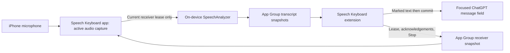

# Live Cross-App Dictation Design Document

## Current Context

- **Objective:** Activate listening in Speech Keyboard once, switch to ChatGPT, focus its message field with Speech Keyboard selected, and see speech appear live. Keep the microphone active across ordinary app switches until explicitly stopped or interrupted by iOS. Preserve spoken wording without an AI rewrite; the user sends messages manually.
- **Status:** Research and implementation plan, November 5, 2026. No application changes or device validation have been performed. The architecture uses documented APIs, but continuous background transcription and live composition in the installed ChatGPT app remain feasibility tests, not established results.
- The app is a SwiftUI starter: [ContentView.swift:10](../Speech%20Keyboard%20Demo/ContentView.swift#L10) renders “Hello, world!”; [SpeechKeyboardDemoApp.swift:10](../Speech%20Keyboard%20Demo/SpeechKeyboardDemoApp.swift#L10) creates the window. There is no recording, speech recognition, extension, shared storage, or test target.
- [project.pbxproj:50](../Speech%20Keyboard%20Demo.xcodeproj/project.pbxproj#L50) defines one app target. It uses synchronized source groups, generated Info.plist settings, automatic signing, bundle ID `com.allensu.SpeechKeyboardDemo`, an iOS 26.1 deployment target (line 181), and MainActor default isolation (line 273). Keep the deployment target for this prototype.
- Xcode 26.1.1 is installed at `/Applications/Xcode.app`. The shell's active developer directory points to Command Line Tools; commands should use `DEVELOPER_DIR=/Applications/Xcode.app/Contents/Developer` without changing the machine-wide selection. The installed iOS 26.1 SDK was inspected to verify Speech and keyboard APIs.

### Research findings

| Question | Evidence | Consequence for Speech Keyboard |
|---|---|---|
| Can recording continue after leaving the app? | Apple documents background recording using an input audio session and `UIBackgroundModes = audio`; other audio sessions can interrupt it. [Background recording](https://developer.apple.com/documentation/avfaudio/avaudiosession/category-swift.struct/record) | Start capture in the foreground and keep actual recording active. This is not a guarantee of an immortal process. |
| Can the keyboard itself record? | Keyboard sandbox restrictions exclude microphone access, including with open access. [Keyboard access](https://developer.apple.com/documentation/uikit/configuring-open-access-for-a-custom-keyboard) | The containing app owns recording and recognition. |
| Can a keyboard receive data and send controls? | App Groups provide shared storage; keyboard Full Access enables shared-container writes. [Keyboard access](https://developer.apple.com/documentation/uikit/configuring-open-access-for-a-custom-keyboard), [sharing data](https://developer.apple.com/library/archive/documentation/General/Conceptual/ExtensibilityPG/ExtensionScenarios.html) | Use shared files for transcripts, receiver state, and Stop commands. Require Full Access for this bidirectional dictation workflow; retain ordinary typing without it. |
| Can live text be revised in another app? | `UITextDocumentProxy.setMarkedText` inserts or replaces an active composition; `unmarkText` commits its displayed text. [Marked text](https://developer.apple.com/documentation/uikit/uitextdocumentproxy/setmarkedtext%28_%3Aselectedrange%3A%29) | Prototype provisional text as a marked composition, then commit final results. Host-app behavior must be tested. |
| Which speech engine fits the project? | SpeechAnalyzer supports on-device, long-form audio and provisional/final results. SpeechTranscriber exposes runtime device and locale checks. [WWDC25](https://developer.apple.com/videos/play/wwdc2025/277/), [SpeechTranscriber](https://developer.apple.com/documentation/speech/speechtranscriber) | Start with native on-device recognition. Download the selected language model during setup; no transcription server is required. |
| Does it work literally everywhere? | Secure fields and certain phone fields use the system keyboard; apps may reject keyboard extensions. [Keyboard limitations](https://developer.apple.com/documentation/uikit/configuring-a-custom-keyboard-interface) | Support compatible focused fields, first verified in ChatGPT. Do not advertise universal insertion. |
| What constrains distribution? | Apple requires functional keyboard input without Full Access, keyboard switching, and clear recording consent/indication. Background services must serve their declared purpose. [Review guidelines §§2.5.4, 2.5.14, 4.4.1](https://developer.apple.com/app-store/review/guidelines/) | Include basic typing and a globe key. Start explicitly, show listening status, and use no silent-audio keepalive or app-launch tricks. Approval remains a separate review outcome. |

**Engineering inference:** These capabilities can be combined into the requested flow. Apple does not document this complete Speech Keyboard-to-ChatGPT integration; Phase 1 must establish it on a physical iPhone before investing in the complete interface.

## Requirements

### Functional Requirements

- One-time onboarding explains microphone access, keyboard installation/selection, Full Access, and model download. Listening starts only after an explicit action in Speech Keyboard.
- Continue microphone capture across ordinary app switching, with no per-utterance activation or silence timeout. iOS's microphone indicator remains visible as the system determines.
- Display provisional words directly in the focused host text field while Speech Keyboard is active; revise only Speech Keyboard's current composition, then commit final recognition results.
- Provide Stop in both the containing app and keyboard. Show waiting, connecting, transcribing, interrupted, and error states accurately.
- Treat “verbatim” as no intentional paraphrasing, filler removal, profanity masking, or LLM cleanup. Recognition may still normalize punctuation/numbers or misrecognize words; evaluate fillers and repetitions explicitly.
- Keep ordinary English typing, shift, numbers/punctuation, space, backspace, return, and keyboard switching available, including without Full Access.
- Do not automatically send messages, read conversations, use the clipboard, or require a ChatGPT API integration.
- When no supported field has an active receiver, keep the listening session armed and capture running, but discard audio instead of queuing a transcript for later insertion. Show “Ready for a text field” in Speech Keyboard. New fields receive only new speech after the keyboard indicates readiness.
- Invalidate pending edits when the user changes fields, moves the cursor, edits manually, or sends/clears a message. Never replay an earlier field's speech into another field.

### Non-Functional Requirements

- Initial scope: one physical iPhone running iOS 26.1 or later, one supported English locale, built-in microphone, and the installed ChatGPT app. Verify the actual device/model availability before implementation proceeds past Phase 1.
- Proposed acceptance targets, **not measured claims**: first visible provisional text within 1 second at p50 and 2 seconds at p95 after model warm-up; shared transport under 250 ms at p95; Stop releases the microphone within 1 second while processes are responsive.
- Demonstrate a 30-minute active session without a forced restart or growing transcript/audio backlog. Measure energy, memory, and temperature, including a silence interval; set energy limits from measured device results rather than inventing battery claims.
- Bound audio buffers, pending segments, and disk snapshots. If the receiver falls behind beyond those bounds, display an error and reset the input epoch instead of silently dropping words or replaying old material.
- Store no raw audio or transcript history. Shared text exists transiently for delivery and is excluded from backups. Logs contain state and timings, never speech or surrounding host text.

## Design Decisions

### 1. Separate the recorder from the keyboard

Use a containing SwiftUI app for permissions, audio, speech assets, session ownership, and a small diagnostic preview. Add a UIKit Custom Keyboard extension for text entry and session controls. Both use an App Group, proposed as `group.com.allensu.SpeechKeyboardDemo`, subject to provisioning availability.

The keyboard cannot start a fresh microphone session by itself. After Stop, force-quit, or an unrecoverable interruption, instruct the user to open Speech Keyboard and start again. Do not rely on private APIs, responder-chain URL workarounds, or launching ChatGPT from the keyboard.

### 2. Use Apple's on-device engine first

Use `SpeechAnalyzer` with `SpeechTranscriber`, enabling `.volatileResults` and `.audioTimeRange`, with empty `transcriptionOptions`. Resolve the supported equivalent locale, check `isAvailable`, reserve/download assets via `AssetInventory`, and prewarm the analyzer. The installed SDK verifies these names; some WWDC sample preset names differ from the shipped SDK.

This keeps the prototype free of a backend, accounts, API keys, and recurring transcription charges. Only model preparation needs a download. Apple's separate `SFSpeechRecognizer` authorization flow does not apply to SpeechAnalyzer modules; request microphone permission and configure `NSMicrophoneUsageDescription`. [Permission distinction](https://developer.apple.com/documentation/speech/asking-permission-to-use-speech-recognition)

If device support, background execution, literal wording, or latency fails the feasibility test, record the failure and revise the engine decision before further implementation. Do not silently switch to cloud processing or the system dictation UI. A hosted streaming engine is an alternative to evaluate at that point, not a second implementation in this plan.

### 3. Keep a continuous capture session, with bounded input destinations

Separate the lifetime of microphone capture from the lifetime of a text destination. A keyboard visibility/focus epoch acts as a short-lived receiver lease. When a new lease is accepted, start a fresh recognition input epoch using only audio captured after acceptance. Reuse/prewarm system model resources where supported; do not carry recognition context or audio from an old field into a new one.

While the lease is absent or expired, discard microphone buffers and stop the recognition task, while continuing the explicitly enabled capture session. This implements continuous readiness without building a background transcript of unrelated conversation. No automatic speaker identification is promised: other audible voices may be recognized while a destination is active.

### 4. Use marked composition for live insertion

Use the public composition APIs first, rather than repeatedly deleting a guessed number of characters. The text proxy exposes a document identifier, but not a transaction across host-app edits; identifier checks alone are insufficient. Observe selection/text callbacks, lifecycle, and expected local context, and verify all of these against ChatGPT. [Document identity](https://developer.apple.com/documentation/uikit/uitextdocumentproxy/documentidentifier)

If the host cannot support reliable composition, the release gate fails. A preview in the keyboard with final-only insertion is a possible revised product behavior, but would **not** satisfy the user's currently requested live-in-field experience.

### 5. Use simple, bounded cross-process storage

Use small Codable snapshots in the App Group, with a single designated writer for each file and atomic replacement. Coordinate reads/writes and document the ownership rules; do not use `UserDefaults` as a streaming message bus. Apple's extension guidance explicitly calls for synchronized shared-container access. [Shared-container coordination](https://developer.apple.com/library/archive/documentation/General/Conceptual/ExtensibilityPG/ExtensionScenarios.html)

Prototype polling at 100 ms in the visible keyboard and 200 ms in the actively recording app; renew leases/status about every 500 ms and expire after 2 seconds. These are initial tuning values. Polling stops when the relevant process is inactive; it cannot wake a suspended app. A growing backlog or stale heartbeat becomes a visible disconnected state.

## Technical Design

### 1. Core Components

| Component | Responsibility |
|---|---|
| `DictationSession` | MainActor UI state and explicit Start/Stop; coordinates audio, engine, leases, interruption handling, and cleanup. |
| `AudioCapture` | Owns AVAudioSession/AVAudioEngine, microphone buffers, timestamps, conversion, route changes, and bounded input queue. |
| `SpeechPipeline` | Owns SpeechAnalyzer, asset preparation, recognition task, range-based provisional/final result reduction, and epoch cancellation. |
| `SessionProtocol` / `SharedSessionStore` | Versioned snapshots, IDs, heartbeat validation, command acknowledgement, atomic storage, and expiry. Compiled into both targets with extension-safe APIs. |
| `KeyboardViewController` | Keyboard lifecycle, text proxy, globe handling, receiver lease, Stop command, state display, and typing actions. |
| `LiveTextComposer` | Pure state reducer plus a narrow proxy adapter; owns only Speech Keyboard's provisional composition and detects invalidation. |
| `KeyboardView` | Small UIKit keyboard and listening/status row, with accessible controls. |

The audio tap must not do file I/O, speech analysis, or wait on the main actor. Copy/enqueue a bounded buffer safely, then convert and consume it off the real-time callback. Use explicit actors/nonisolated Sendable models as needed because the existing app defaults to MainActor isolation.

Start with an input-only `.record` audio session for the built-in mic. Handle the fact that it may interrupt other audio; media playback and ChatGPT voice mode are not simultaneous-use guarantees. Route changes require a new compatible conversion format. Handle audio interruptions and media-services resets explicitly. [Audio interruption behavior](https://developer.apple.com/documentation/avfaudio/avaudiosession/interruptionnotification)

Session states: `idle → preparing → listening`; listening can be `waitingForField` or `transcribing(epoch)`. Stop transitions through `stopping → idle`; interruptions/errors invalidate the epoch and show `interrupted` or `failed`. Starting is idempotent. Generation IDs ensure an old asynchronous task cannot publish into a new session. Silence alone never stops capture.

### 2. Data Models

| Model/file | Fields and ownership |
|---|---|
| `SessionSnapshot` / `session.json` | App-written: schema version, capture session UUID, state, monotonic heartbeat, active input epoch, acknowledged command ID, sanitized error code. |
| `ReceiverSnapshot` / `receiver.json` | Keyboard-written: capture session UUID, keyboard-instance UUID, input-epoch UUID, lease heartbeat, last consumed segment/revision, optional Stop command UUID. Do not serialize host text or app identity. |
| `TranscriptSnapshot` / `transcript.json` | App-written: session/epoch IDs, publication revision, bounded ordered final segments awaiting acknowledgement, and current provisional segments. Each segment has an epoch-local ID, audio time range, text, and finality. |
| `CompositionState` / memory only | Keyboard: current document UUID, epoch, applied revisions, owned provisional string, and minimal expected context used only to detect edits. Never persisted or logged. |

- Use a monotonic clock for same-boot leases and reject state from unknown sessions/reboots. Schema mismatch, malformed/oversized data, inaccessible protected files, stale heartbeats, and decreasing revisions all disconnect dictation safely.
- Reduce recognition updates by audio range and finality, not by appending every partial result. Later revisions replace the appropriate provisional range; finalized ranges do not get inserted twice. Support results that alter range boundaries.
- Keep final segments until the live receiver acknowledges application. Cap pending data, initially at 64 KB/30 seconds, and surface overflow. Do not prune unseen final segments merely because a newer partial arrived.
- Stop is idempotent and remains in the receiver snapshot until the app acknowledges it. Serialize updates from multiple extension instances with a short cross-process lock; ownership transfers to the newest visible receiver. A former instance must not renew or overwrite another instance's lease.
- Delivery is ordered and deduplicated within a live input epoch. There is no atomic transaction between shared storage and a foreign text field. After extension death/recreation, start a new epoch and never replay uncertain prior text; a last provisional phrase may remain incomplete, but it must not duplicate into a different field.

### 3. Integration Points

**Startup and insertion contract**

1. On Start, check microphone permission/model readiness, create a new capture session, purge expired shared text, and activate audio. Publish status only after capture succeeds.
2. On keyboard appearance with Full Access and a fresh session, acquire receiver ownership and publish a new input epoch. Show “Connecting” until the app acknowledges that epoch; only then show “Listening.”
3. Associate each audio buffer/result with its capture session and input epoch. Late work from a cancelled epoch is discarded. The transcript snapshot must never implicitly change destinations.
4. On a new provisional phrase, call `setMarkedText` with a collapsed selection at its UTF-16 end. Update the marked composition as recognition revises it. On finalization, replace it with the final text and call `unmarkText`; do not append that final text a second time. Handle multiple finalized ranges in order, preserving engine spacing.
5. Before touching the proxy, confirm visibility, document identity, current epoch, fresh app heartbeat, and that no external edit invalidated composition ownership. Distinguish expected callbacks caused by our own operations from external edits; test asynchronous callback delivery rather than relying on a synchronous Boolean guard.
6. Before manual keyboard input, finish ownership of the visible provisional text, cancel the old recognition epoch, apply the user's key, and establish a fresh epoch. Selection/cursor movement, host edits, Send/field-clear, disappearance, and keyboard switching also invalidate the epoch. Do not overwrite a user's selection automatically; show insertion paused until a caret is restored.
7. When leaving a field, unmark only while the proxy still belongs to that same field. If ownership is uncertain, do not attempt deletion or cleanup in the newly focused field. Drop old recognition updates. Automatically establish a new epoch for a valid new caret; no per-message microphone activation is needed.
8. On Stop, stop audio input immediately, request bounded finalization of the current stream, deliver final text only to the still-valid receiver, deactivate the audio session, acknowledge Stop, and clear shared text after acknowledgement or a short expiry. The keyboard shows “Stopping” until acknowledgement; a timeout shows “Connection lost—open Speech Keyboard to check listening.” Never claim the mic has stopped based solely on sending a command.

Use a collapsed selection and UTF-16 offsets correctly for emoji/combining characters. If ChatGPT's composition callbacks cannot establish safe ownership, pause updates and report the issue rather than guessing with backspaces.

**Interruption and lock contract**

- Incoming calls, Siri, ChatGPT voice mode, or other microphone contention may end the audio session. Publish interrupted state when execution permits; keyboard heartbeats detect otherwise unreported termination. Require reopening Speech Keyboard to recover when iOS cannot reactivate in the background.
- Locking the phone may leave capture running, but expires the receiver. No transcript is queued while locked. Protected-data failures must not crash the recorder or cause stale delivery after unlock.
- Force-quitting/rebooting ends listening. Never restart automatically on launch. Stop in the containing app is always available when it is opened.

### 4. Files Changes

This plan adds only `plans/live-dictation.md`. The later implementation is scoped to the following files; no unrelated project cleanup is planned.

| File | Planned change |
|---|---|
| `Speech Keyboard Demo.xcodeproj/project.pbxproj` | Add/embed keyboard target, shared source membership, test target, App Group entitlements, microphone description, `UIBackgroundModes = audio`, and extension-safe build settings. Preserve current identifiers/signing defaults where possible. |
| `Speech Keyboard Demo.xcodeproj/xcshareddata/xcschemes/Speech Keyboard Demo.xcscheme` | Shared app/test scheme for reproducible builds. |
| `Speech Keyboard Demo/SpeechKeyboardDemoApp.swift` | Own and inject the session controller. |
| `Speech Keyboard Demo/ContentView.swift` | Setup guidance, Start/Stop, model-download progress, recording state, and diagnostics. |
| `Speech Keyboard Demo/Dictation/DictationSession.swift` | Session state machine, lease/control loop, and lifecycle. |
| `Speech Keyboard Demo/Dictation/AudioCapture.swift` | Audio capture, conversion, buffer bounds, and interruptions. |
| `Speech Keyboard Demo/Dictation/SpeechPipeline.swift` | Model preparation and range-based streaming transcription. |
| `Speech Keyboard Demo/Speech Keyboard Demo.entitlements` | App Group capability. |
| `Shared/SessionProtocol.swift` | Versioned Codable/Sendable transport models and shared constants. |
| `Shared/SharedSessionStore.swift` | Coordinated atomic file transport, lease ownership, expiry, and cleanup. |
| `SpeechKeyboard/KeyboardViewController.swift` | Extension controller, proxy adapter, polling, and controls. |
| `SpeechKeyboard/KeyboardView.swift` | Basic typing layout, globe, Stop, and status UI. |
| `SpeechKeyboard/LiveTextComposer.swift` | Composition reducer, revision checks, and destination invalidation. |
| `SpeechKeyboard/Info.plist` | `com.apple.keyboard-service`, principal class, `PrimaryLanguage`, `IsASCIICapable`, and `RequestsOpenAccess = YES`. |
| `SpeechKeyboard/SpeechKeyboard.entitlements` | Same App Group as app. |
| `SpeechKeyboardDemoTests/SessionProtocolTests.swift` | Epochs, ownership, timeouts, command acknowledgements, and stale data. |
| `SpeechKeyboardDemoTests/LiveTextComposerTests.swift` | Provisional/final/edit interleavings using a fake text proxy. |
| `SpeechKeyboardDemoTests/SpeechPipelineTests.swift` | Range revisions, finality, cancellation, and input overflow with synthetic events. |
| `SpeechKeyboardDemoTests/SharedSessionStoreTests.swift` | Atomic reads/writes, contention, malformed data, limits, and cleanup in a temporary container. |
| `plans/live-dictation-validation.md` | Device/OS/ChatGPT versions, milestone evidence, timings, failure cases, and release decision. |

Keep shared files outside the synchronized app directory and explicitly include them in both targets. Keep microphone and Speech code out of the keyboard extension. Use generated Info.plist settings for the app; do not introduce a conflicting second app plist.

## Implementation Plan

1. **Phase 1 — Prove the complete path on a phone.**
   - Configure the keyboard target, signing/App Group, microphone permission, and background audio mode. Confirm the keyboard can type static text in ChatGPT before adding recognition.
   - Add the thinnest capture → on-device provisional/final results → shared snapshots → marked-text insertion path. Use the intended component files rather than a throwaway architecture.
   - Test five minutes in ChatGPT while Speech Keyboard is backgrounded, including a silence interval, app switch, phrase revision, typed correction, cursor move, Send, and a second message. Verify Stop from the keyboard and Full Access denial behavior.
   - Measure end-to-end latency and test recorded utterances containing repetitions/fillers against expected words. No LLM cleanup.
   - **Exit gate:** live speech appears inside ChatGPT, final results do not duplicate, existing/user-edited text survives, background recognition continues, and Stop releases capture. Record failures and change the design before proceeding if any gate fails. No simulator-only signoff.

2. **Phase 2 — Make delivery and session behavior reliable.**
   - Implement leases, epoch isolation, acknowledgements, bounded queues, atomic storage, stale-state handling, and the complete composition reducer.
   - Implement deterministic Stop/cancellation and interruption states. Exercise late results, extension recreation, input-destination changes, and process termination.
   - Add the focused unit/integration tests listed below. Keep the current UI minimal until reliability is established.
   - **Exit gate:** no replay across fields or session restarts; edit/selection tests pass; storage stays bounded; failure states match actual capture state.

3. **Phase 3 — Complete setup and usable keyboard.**
   - Add onboarding, runtime locale/device support checks, model progress/retry, denied-permission guidance, and accurate recording/status presentation.
   - Complete basic typing/number/symbol controls, globe switching, Stop, accessibility labels, and layouts appropriate to the existing supported device families.
   - Explain Full Access as shared control/data access, with on-device processing. Verify basic typing still works when permission is absent or revoked.
   - **Exit gate:** a fresh install can be configured and used without Xcode assistance; the user starts once and dictates multiple messages/app switches without returning to Speech Keyboard during an uninterrupted session.

4. **Phase 4 — Validate sustained use and document the supported behavior.**
   - Run the 30-minute device matrix and collect latency, memory, energy, recognition, and interruption evidence.
   - Verify Notes and one additional compatible app for cross-app behavior; ChatGPT remains the primary acceptance target.
   - Document known failures, unsupported fields, exact device/software versions, and any required changes before wider distribution.
   - **Exit gate:** supported behavior is demonstrated, material failures are resolved or clearly bound, and no voice/text content appears in logs or retained files.

No deadline was supplied. Progress is gated by observed behavior, with the highest-risk device experiment first.

## Testing Strategy

### Unit Tests

- Composition event sequences: partial A → revised B → final C; duplicate/out-of-order updates; overlapping audio ranges; multiple finals before one poll; empty results; punctuation/spacing; emoji and combining characters.
- Field lifecycle: document change, same-document caret movement, nonempty selection, manual typing/deletion, host Send/clear, keyboard switch, stale async callbacks, extension restart, and a final result arriving after Stop or a new epoch.
- Transport: concurrent readers/writers, replacement during read, competing receiver instances, expiry, restart, corrupt/version-mismatched data, permission loss, oversized snapshots, acknowledgement loss, and repeat Stop commands.
- Audio/session reducers: startup failure, model download failure, unsupported device/locale, bounded-buffer overflow, interruption during preparation/finalization, and late tasks after cancellation.
- Assert proxy operations and final text preservation, not private implementation details. Use synthetic recognition events and injected clocks; no unit test depends on a live microphone or internet.

### Integration Tests

| Scenario | Required outcome |
|---|---|
| Start in Speech Keyboard → switch to ChatGPT → focus field → speak | Live provisional words in the message field; final text commits once. |
| Speak before any field is ready, then focus a field | Earlier speech is not inserted; readiness is visible. |
| Long pauses and 30-minute capture | No app-imposed timeout, growing queues, or silent loss of recording state. |
| Edit, select, move cursor, Send, start second message | User text preserved; late results cannot recreate sent text or target another field. |
| App/field/keyboard switching | Current receiver gets new speech only; old epochs cannot renew ownership. |
| Stop from either surface, including during speech | Prompt microphone release; bounded finalization; no false stopped acknowledgement. |
| Force-quit app or recreate extension | Stale state detected; no replay or automatic microphone restart. |
| Calls, Siri, ChatGPT voice, media playback, route changes | Accurate interruption/error reporting; no attempt to override another mic owner. |
| Lock/unlock and protected storage unavailable | No queued transcript appears after unlock; fresh epoch required. |
| Full Access off/revoked; microphone denied/revoked | Typing remains functional; dictation gives actionable status and does not spin indefinitely. |
| Offline after assets installed; failed model download | Local recognition works where supported; failed setup remains recoverable. |
| Secure/phone fields and incompatible host apps | No attempted injection; limitations match platform behavior. |

- Build and run pure tests with Xcode 26.1.1 using a simulator where available. Validate signing, microphone, background scheduling, model execution, shared permissions, and ChatGPT integration on a physical phone.
- Do the background endurance run without an attached debugger; debugging may change scheduling behavior. Record OS, device, app build, and ChatGPT version with results.
- Compare a small agreed utterance set for word errors and filler/repetition preservation. Treat systematic omission of spoken words as a decision point for the engine, not permission to redefine “verbatim.”

## Observability

### Logging

- Use OSLog categories for session, audio, speech, transport, and composition. Log transitions, sanitized error codes, stale/overflow counters, and timing signposts.
- Do not log microphone samples, recognizer output, host context, typed characters, or persistent document identifiers. Use ephemeral correlation IDs.

### Metrics

- Record startup/model-preparation time, audio-to-first-visible-text latency, result-to-insertion delay, finalization delay, Stop-to-mic-release time, and interruption counts.
- Measure process memory, pending-byte count, energy/thermal behavior, and audio queue depth during device tests. Keep metrics local; no analytics service is needed for the prototype.

## Future Considerations

### Potential Enhancements

### Known Limitations

- “Invisible” means the app can remain backgrounded; the microphone indicator and selected custom keyboard remain visible.
- No guarantee of indefinite execution, resumption after force-quit, simultaneous mic ownership, or compatibility with every app/text field.
- Text entered by the user remains in the receiving app and follows that app's data handling. On-device audio processing does not make a submitted ChatGPT message local-only.
- Speech recognition is fallible and may normalize wording. The native engine must be evaluated for the requested verbatim behavior.
- Compatibility of marked composition, frequent updates, and host-app editing is the principal unresolved risk.
- While no valid receiver exists, speech is discarded. During reconnects, users must wait for the keyboard's ready state before speaking.

## Dependencies

### Development Dependencies

- Installed Xcode 26.1.1/iOS 26.1 SDK; SwiftUI, UIKit, AVFAudio, Speech, Foundation, and XCTest. No third-party package or backend is planned.
- Apple signing credentials/provisioning that support the app, keyboard extension, and shared App Group. The project's team ID is already set; capability availability has not been verified.
- A supported physical iPhone and installed ChatGPT app. Device connection, supported speech locale/model, and ChatGPT keyboard behavior are not yet verified.
- Internet access for initial model download if the needed assets are absent.

## Security Considerations

- Explicit Start and an accurate microphone usage description precede recording. Provide visible listening state and Stop; do not hide or bypass iOS indicators.
- Full Access is required for receiver leases, acknowledgements, and Stop writes in this design, not to send speech to a server. Do not request unrelated permissions or transmit keyboard data.
- Use protected App Group files, exclude transient snapshots from backups, and remove transcript content on acknowledgement, expiry, Stop, and next launch. A process crash can leave protected bytes on disk until cleanup; never claim instant secure deletion.
- Validate IDs, bounds, schema, and file content before applying input. Retain only the minimum local context needed for safe composition; never export it to shared storage.
- Ship basic keyboard functionality without Full Access as required by Apple's keyboard rules. Prepare recording/privacy explanations before any distribution. [Review guidelines](https://developer.apple.com/app-store/review/guidelines/)

## Rollout Strategy

1. Local development and physical-device feasibility gate; no publishing or signing-account changes are part of this planning task.
2. Personal device prototype after the continuous-dictation and text-preservation tests pass.
3. Broader testing only after the supported device/host behavior is documented. TestFlight or App Store submission is a separate action, with review notes explaining user-initiated background capture and keyboard permissions.

## References

- [Background recording and interruptions](https://developer.apple.com/documentation/avfaudio/avaudiosession/category-swift.struct/record)
- [Creating a custom keyboard](https://developer.apple.com/documentation/uikit/creating-a-custom-keyboard)
- [Keyboard Full Access](https://developer.apple.com/documentation/uikit/configuring-open-access-for-a-custom-keyboard)
- [Keyboard interface and unsupported fields](https://developer.apple.com/documentation/uikit/configuring-a-custom-keyboard-interface)
- [App extension shared-container coordination](https://developer.apple.com/library/archive/documentation/General/Conceptual/ExtensibilityPG/ExtensionScenarios.html)
- [Marked-text insertion](https://developer.apple.com/documentation/uikit/uitextdocumentproxy/setmarkedtext%28_%3Aselectedrange%3A%29)
- [Text document identifier](https://developer.apple.com/documentation/uikit/uitextdocumentproxy/documentidentifier)
- [SpeechAnalyzer overview](https://developer.apple.com/documentation/speech/speechanalyzer)
- [SpeechTranscriber availability and locale support](https://developer.apple.com/documentation/speech/speechtranscriber)
- [SpeechAnalyzer WWDC25 overview and live example](https://developer.apple.com/videos/play/wwdc2025/277/)
- [Speech permission scope](https://developer.apple.com/documentation/speech/asking-permission-to-use-speech-recognition)
- [Audio interruption notification](https://developer.apple.com/documentation/avfaudio/avaudiosession/interruptionnotification)
- [App Review Guidelines](https://developer.apple.com/app-store/review/guidelines/)
- Installed SDK source checks: `UIKit.framework/Headers/UIInputViewController.h` (proxy identity, marked text, keyboard switching); `Speech.framework/Modules/Speech.swiftmodule/arm64e-apple-ios.swiftinterface` (asset reservation, transcriber options/results, finalization); `AVFAudio.framework/Headers/AVAudioSessionTypes.h` (session categories and mixing). SDK root: `/Applications/Xcode.app/Contents/Developer/Platforms/iPhoneOS.platform/Developer/SDKs/iPhoneOS.sdk`.
